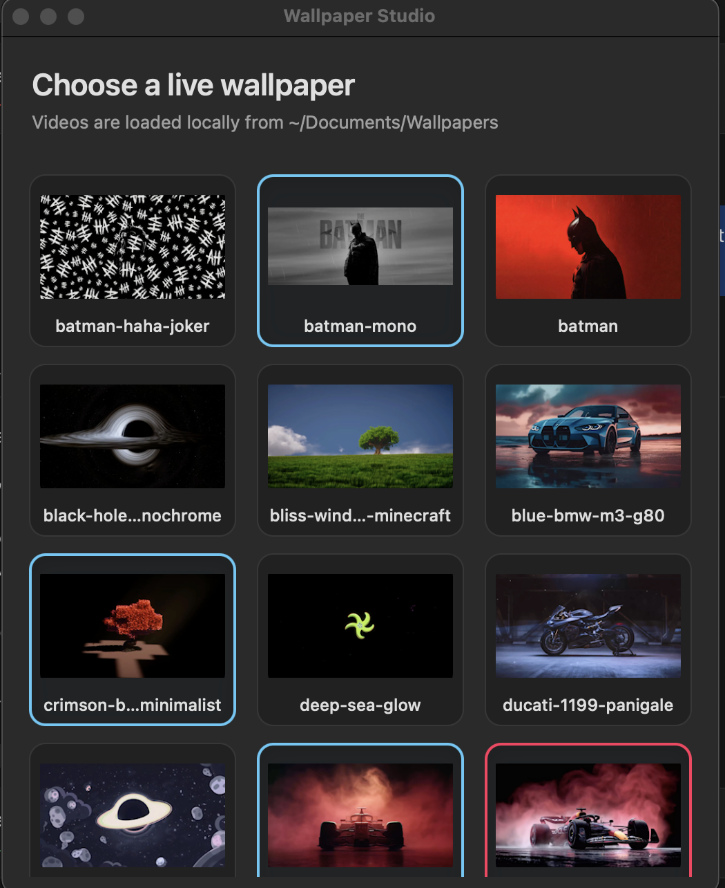

# Wallpaper Studio

Wallpaper Studio is a lightweight, local-only macOS live wallpaper player. It runs as a menu-bar utility, supports multiple monitors, and lets you switch between MP4 wallpapers without restarting the app.



The app opens a visual grid of wallpaper thumbnails so you can preview and select a live wallpaper with the mouse or keyboard.

## Features

- One live wallpaper window per connected display.
- Loops MP4 videos continuously using AVFoundation.
- Supports separate monitor resolutions and arrangements.
- Matching Wallpaper Studio icon in the menu bar opens the thumbnail grid directly.
- Updates macOS’s static desktop wallpaper to match the selected live wallpaper as a fallback.
- Automatically scans `~/Documents/Wallpapers`.
- Lets each user choose a different wallpaper folder from the picker.
- “Rescan Wallpaper Folder” for newly added videos.
- No upload, account, subscription, or network service required.

## Requirements

- macOS 15 or newer.
- Swift compiler and AppKit/AVFoundation frameworks (Xcode Command Line Tools).
- At least one MP4 file in `~/Documents/Wallpapers`.

## Install the packaged app

GitHub Actions produces `Wallpaper-Studio-macos.zip` and `Wallpaper-Studio-macos.dmg`:

1. Open the DMG, or unzip the archive.
2. Drag `Wallpaper Studio.app` to the `Applications` shortcut in the DMG window.
3. Copy MP4 files into `~/Documents/Wallpapers`, or use **Choose Wallpaper Folder…** inside the app.
4. Open the app and click the Wallpaper Studio icon in the menu bar.
5. Select any wallpaper from the thumbnail grid.

If macOS shows a security warning for an unsigned build, use Finder’s Open command from the app’s context menu once.

## Build locally

```sh
./build.sh
```

The script compiles the Swift source, assembles the app bundle, installs it at `~/Applications/Wallpaper Studio.app`, and launches it.

## Wallpaper folder

By default, put wallpapers here:

```text
~/Documents/Wallpapers
```

Only `.mp4` files are shown. Add a video and reopen the thumbnail grid from the Wallpaper Studio menu-bar icon.

To use another location, open the app’s picker and click **Choose Wallpaper Folder…**. The selected folder is saved for that macOS user and is used automatically on future launches. The app creates the default folder if it does not exist.

## Repository layout

```text
WallpaperStudio.swift              App source
Info.plist                         macOS app metadata
Resources/BatmanLiveWallpaper.icns App icon
build.sh                           Local build and launch script
.github/workflows/build.yml        GitHub Actions packaging workflow
```

## Release process

Installable files are generated when a version tag is pushed. The GitHub Actions workflow runs on `macos-latest`, compiles the app, creates `Wallpaper Studio.app`, packages it as both a ZIP and a DMG with an Applications shortcut, and publishes both files to a GitHub Release.

From a clean working tree:

```sh
git add .
git commit -m "Describe the change"
git push origin main
git tag v1.0.0
git push origin v1.0.0
```

Then open the repository’s **Releases** page and download either:

- `Wallpaper-Studio-macos.dmg` — recommended drag-and-drop installer.
- `Wallpaper-Studio-macos.zip` — portable app archive.

The workflow also supports manual runs from the **Actions** tab. Manual runs create artifacts but do not publish a release unless they are triggered by a `v*` tag.

## Limitations

- Wallpaper videos are supplied by the user and are not bundled.
- The app is unsigned and not notarized.
- On first launch, the app registers itself as a macOS login item and starts automatically after future logins. macOS may require approval in System Settings → General → Login Items.

## License

This repository contains the Wallpaper Studio application code. Wallpaper videos remain the property of their respective creators and are not included in the distributable app.
